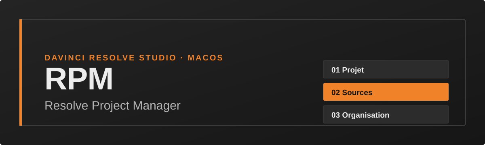
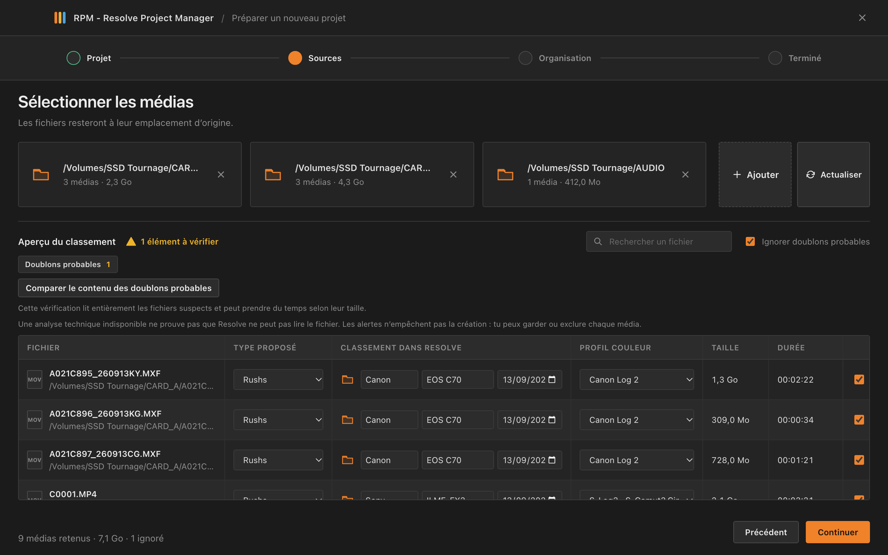
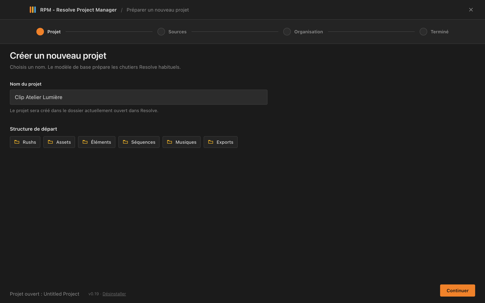
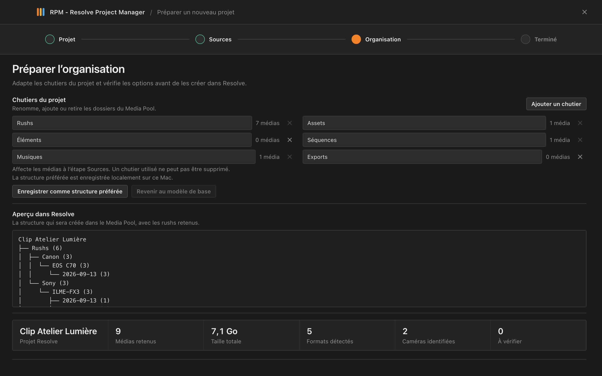
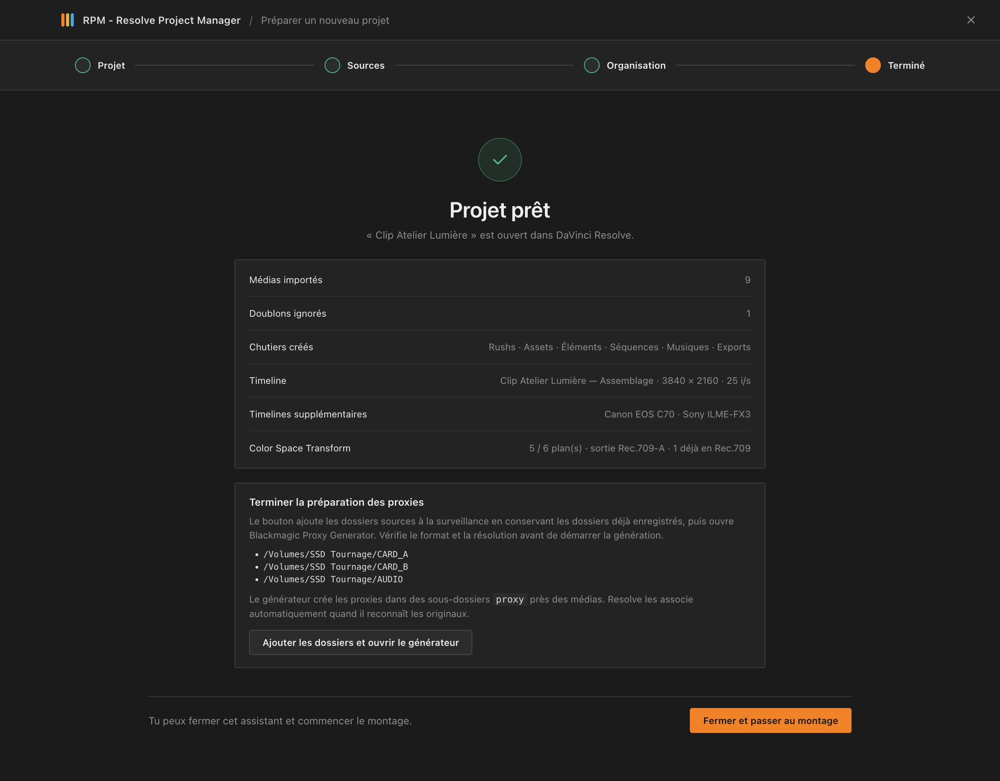

<p align="center">
  
</p>

<p align="center">
  <b>Français</b> · <a href="README.en.md">English</a>
</p>

<p align="center">
  <a href="https://github.com/plouis375/rpm-resolve-project-manager/releases/latest"></a>
  
  
  
</p>

<h3 align="center">De la carte mémoire à la timeline, en quatre étapes.</h3>

<p align="center">
  Un assistant pour <strong>DaVinci Resolve Studio</strong> qui crée le projet, range les rushs par caméra et par jour,<br>
  applique le bon Color Space Transform et prépare la timeline d’assemblage. Puis il s’efface.
</p>

<p align="center">
  <a href="https://github.com/plouis375/rpm-resolve-project-manager/releases/latest"></a>
</p>

<p align="center">
  <a href="#installation">Installation</a> ·
  <a href="#utilisation">Utilisation</a> ·
  <a href="#cst">CST</a> ·
  <a href="#depannage">Dépannage</a> ·
  <a href="CHANGELOG.md">Historique des versions</a>
</p>

<br>

<p align="center">
  
</p>

<br>

## ✦ Ce qu’il fait

<table>
  <tr>
    <td width="33%" valign="top">
      <h4>🗂️ Classement automatique</h4>
      Les rushs sont rangés par <b>marque</b>, <b>modèle</b> et <b>date de tournage</b>, lus dans les métadonnées et les XML sidecar Canon et Sony.
    </td>
    <td width="33%" valign="top">
      <h4>🔍 Analyse des sources</h4>
      Médias reconnus, durée, taille, alertes. Les <b>doublons probables</b> sont repérés, puis confirmés au besoin par empreinte SHA-256.
    </td>
    <td width="33%" valign="top">
      <h4>🎬 Projet prêt à monter</h4>
      Projet, chutiers et imports créés dans Resolve, avec un <b>rapport final</b> des imports réussis et de ceux à vérifier.
    </td>
  </tr>
  <tr>
    <td width="33%" valign="top">
      <h4>🎞️ Timelines d’assemblage</h4>
      Résolution et fréquence réglables ou automatiques, plus des timelines <b>par caméra</b> ou <b>par jour</b> si tu le souhaites.
    </td>
    <td width="33%" valign="top">
      <h4>🎨 Color Space Transform</h4>
      Un node CST sur chaque plan selon son <b>profil log</b> détecté : S-Log3, Canon Log 2, Canon Log 3. Sortie Rec.709-A ou Gamma 2.4.
    </td>
    <td width="33%" valign="top">
      <h4>⚡ Proxies</h4>
      Les dossiers sources sont confiés à <b>Blackmagic Proxy Generator</b>, qui écrit les proxies à côté des médias.
    </td>
  </tr>
</table>

> [!NOTE]
> RPM travaille **dans Resolve** : il ne crée pas de dossiers Finder, ne déplace pas les sources, et ne modifie ni ne supprime jamais les fichiers originaux. Il ne copie une carte que si tu le demandes (voir *Copie des cartes*).

<a id="installation"></a>

## ⬇️ Installation

| Étape | |
|---|---|
| **1. Télécharger** | Récupère le fichier `.pkg` de la [dernière version](https://github.com/plouis375/rpm-resolve-project-manager/releases/latest). |
| **2. Installer** | Ferme DaVinci Resolve, puis ouvre le `.pkg`. L’installeur demande ton mot de passe administrateur pour copier le plugin dans le dossier partagé de Resolve. |
| **3. Autoriser** | Si macOS bloque le paquet, ouvre **Réglages Système → Confidentialité et sécurité** et choisis **Ouvrir quand même**. |
| **4. Lancer** | Rouvre Resolve : **Workspace → Workflow Integrations → RPM - Resolve Project Manager**. |

> [!IMPORTANT]
> Le paquet n’est ni signé ni notarié (pas de compte développeur Apple), d’où l’étape 3. Après une mise à jour, **redémarre Resolve** avant d’ouvrir le plugin.

<details>
<summary><b>Prérequis</b></summary>
<br>

- macOS et DaVinci Resolve Studio. Testé avec **Resolve Studio 21.1.1** ; les autres versions peuvent se comporter différemment.
- Une bibliothèque de projets Resolve accessible.
- Les médias source accessibles depuis ce Mac (disque local ou volume monté).
- `ffprobe` est inclus, universel Intel et Apple Silicon. S’il ne peut pas tourner, le plugin tente une analyse partielle avec Spotlight.

</details>

<details>
<summary><b>Langue</b></summary>
<br>

L’interface existe en **français et en anglais**. Elle suit la langue de macOS par défaut (français, sinon anglais). Change-la avec la liste **Langue** de la première étape ; le choix est mémorisé. Le [README en anglais](README.en.md) est aussi disponible.

</details>

<details>
<summary><b>Mise à jour et désinstallation</b></summary>
<br>

- Une sauvegarde horodatée de la version précédente est conservée dans `.backups`, dans le dossier des intégrations Resolve.
- **Désinstaller** : bouton en bas de la première étape du plugin, puis redémarre Resolve. Les projets et les médias ne sont pas supprimés.

</details>

<a id="utilisation"></a>

## 🧭 En quatre étapes

<table>
  <tr>
    <td width="50%" valign="top">
      
      <h4>01 · Projet</h4>
      Saisis le nom du projet. Il est créé dans la bibliothèque et le dossier sélectionnés dans Resolve.
    </td>
    <td width="50%" valign="top">
      
      <h4>02 · Sources</h4>
      Ajoute un ou plusieurs dossiers (sous-dossiers compris). Cherche, reclasse ou exclus un fichier. <b>Actualiser</b> repère les nouveaux médias en conservant tes corrections.
    </td>
  </tr>
  <tr>
    <td width="50%" valign="top">
      
      <h4>03 · Organisation</h4>
      Renomme, ajoute ou retire les chutiers, règle la timeline. Un aperçu montre l’arborescence finale. Enregistre ta structure pour les prochains projets.
    </td>
    <td width="50%" valign="top">
      
      <h4>04 · Terminé</h4>
      Le projet est créé, les médias importés. Le rapport résume tout, et le bouton final ouvre la page <b>Edit</b> en fermant l’assistant.
    </td>
  </tr>
</table>

## 🗂️ Organisation créée dans Resolve

```text
Nom du projet
├── Rushs
│   └── Marque de caméra
│       └── Modèle
│           └── Date de tournage
├── Son
├── Assets
├── Éléments
├── Séquences
├── Musiques
└── Exports
```

Les autres types de médias vont directement dans leur chutier. La structure se modifie avant la création : **Enregistrer comme structure préférée** la garde sur ce Mac, **Revenir au modèle de base** l’efface.

Pour la date de tournage, le plugin lit les métadonnées, avec en repli la date de création du fichier (signalée dans l’analyse). L’étape Organisation peut aussi proposer de **regrouper des noms de caméra proches** ; rien ne change tant que tu ne cliques pas sur **Regrouper**.

## 🎞️ Timeline d’assemblage

Option facultative : Resolve crée `Nom du projet — Assemblage` dans le chutier Séquences, rushs retenus bout à bout.

| Réglage | Choix |
|---|---|
| **Résolution** | HD, Full HD, 2K/4K DCI, Ultra HD, vertical ou carré |
| **Fréquence** | de 23,976 à 60 i/s |
| **Automatique** | format majoritaire des rushs, sinon 1920 × 1080 à 24 i/s |
| **Ordre des plans** | timecode (toutes caméras confondues), heure d’enregistrement, ou par caméra |
| **Timelines en plus** | une par caméra et/ou une par jour de tournage |

C’est un point de départ : la timeline ne coupe pas les plans et ne choisit pas de prises. Les plans sont rangés jour par jour ; un plan sans timecode est placé selon son heure d’enregistrement.

## 🎙️ Synchro du son

Avec **Synchroniser le son enregistré à part**, Resolve associe les fichiers **WAV et AIFF** retenus aux rushs du même jour de tournage, juste après l’import :

| Mode | Quand l’utiliser |
|---|---|
| **Timecode** | enregistreur et caméras calés sur le même timecode au tournage |
| **Forme d’onde** | pas de timecode commun, mais un son témoin audible sur les caméras |

Le son caméra est conservé, et les timelines d’assemblage reprennent le son synchronisé. La synchro se fait jour par jour, car un timecode « heure du jour » se répète d’un jour à l’autre. La date d’un fichier son vient de ses métadonnées BWF, sinon de sa date de création. Elle se corrige à l’étape Sources, et les WAV et AIFF vont par défaut dans le chutier **Son** (les MP3 et autres restent dans Musiques). Le rapport final liste les jours que Resolve n’a pas confirmés.

## 🎬 Clips multicam

Avec **Créer un clip multicam par jour**, chaque jour de tournage qui compte au moins deux rushs reçoit un clip multicam dans Séquences : un angle par fichier, calé par timecode ou par forme d’onde selon le réglage « Synchroniser par ». Le son direct déjà synchronisé suit les plans.

## 🎨 Couleur de clip par caméra

Avec **Colorer les clips par caméra**, chaque rush reçoit une couleur de clip Resolve selon sa caméra. La couleur ne dépend que de la marque et du modèle : un FX3 garde la même couleur d’un projet à l’autre. Deux caméras peuvent tomber sur la même couleur, car Resolve n’en propose que 16.

## 🏷️ Métadonnées des rushs

Avec **Écrire les métadonnées des rushs**, chaque rush reçoit dans Resolve : **Camera Type** (marque et modèle), **Camera #** (numéro par caméra), **Date Recorded** (jour de tournage) et **Description** (dossier source). Tu peux alors filtrer le Media Pool ou créer des smart bins. Les champs que Resolve refuse sont listés dans le rapport final. Le profil couleur n’est pas écrit : Resolve n’a pas de champ standard pour lui.

## 🎛️ Gestion couleur du projet

À côté du node CST, la méthode **Gestion couleur du projet** passe le projet en *DaVinci YRGB Color Managed* (mode « SDR Rec.709 », gestion automatique désactivée, sortie Rec.709-A ou Gamma 2.4) et règle l’espace d’entrée de chaque clip selon son profil couleur. C’est presque instantané, cela s’applique à toutes les timelines et ne demande pas d’en créer une. Les clips ou réglages que Resolve refuse sont listés dans le rapport.

## ⚙️ Preset de réglages de projet

Si tu as enregistré des presets de réglages de projet dans Resolve, une liste les propose à l’étape Organisation. Le preset est appliqué au projet créé, avant le format de timeline et la gestion couleur choisis dans l’assistant, qui gardent donc le dernier mot.

## 🔗 Proxies existants

Si un rush a déjà un proxy dans un sous-dossier `proxy` voisin (même nom de fichier, extension vidéo quelconque), il est lié automatiquement au plan après l’import. Le rapport final compte les proxies liés. Cela évite de régénérer des proxies déjà faits.

## 📄 Rapport exporté

À l’étape Terminé, **Exporter le rapport** enregistre un fichier TXT ou CSV : statut de chaque fichier, plans sans CST, jours dont la synchro n’est pas confirmée, éléments refusés par Resolve et avertissements techniques. Le CSV s’ouvre directement dans Excel.

## 🔔 Mises à jour

À l’ouverture, un bandeau discret signale qu’une version plus récente est publiée sur GitHub. Rien n’est téléchargé ni installé automatiquement, et hors ligne le plugin reste silencieux.

## 💾 Copie des cartes

À l’étape Sources, **Copier une carte avec vérification** copie une carte mémoire avec le Clone Tool de Resolve : choisis la carte, la destination (et une seconde copie de sauvegarde si besoin) et la vérification (MD5, SHA-256, xxHash 64 ou taille seule). La copie vérifiée est ensuite ajoutée aux sources. La carte d’origine n’est jamais modifiée, et rien n’est copié sans que tu le demandes.

<a id="cst"></a>

## 🎨 Color Space Transform

Avec **Appliquer un Color Space Transform**, chaque plan reçoit un node CST selon son profil couleur, détecté plan par plan à l’étape Sources (colonne **Profil couleur**) et modifiable à la main.

| Caméras | Profil d’entrée |
|---|---|
| Sony FX3 · FX30 · FX6 · FX9 · Burano · A7S III · A7 IV · A1 · A7R V · ZV-E1 · FR7 | S-Gamut3.Cine / S-Log3 |
| Canon C50 · C70 | Cinema Gamut / Canon Log 2 |
| Canon R5 | Cinema Gamut / Canon Log 3 |

Dix autres profils se choisissent à la main dans la colonne **Profil couleur** : Panasonic V-Log, Fujifilm F-Log et F-Log2, Nikon N-Log, DJI D-Log, Apple Log, ARRI LogC3 et LogC4, RED Log3G10, Blackmagic Film Gen 5. Ils n’ont pas de preset `.drx` et demandent la méthode **Gestion couleur du projet**.

**Sortie** : Rec.709-A (visionnage sur Mac) ou Rec.709 Gamma 2.4 (diffusion).

> [!TIP]
> Pour les Sony, le gamma enregistré dans le XML sidecar prime sur le modèle : un plan en S-Log3 reçoit le CST, un plan en Rec.709, HLG ou S-Cinetone n’en reçoit pas. Un autre log (S-Log2, par exemple) n’a pas de preset : choisis son profil à la main.

Les plans sans profil restent sans étalonnage et sont signalés dans le rapport. Avec beaucoup de rushs, cette étape peut être longue.

## ⚡ Proxies avec Blackmagic Proxy Generator

Coche **Préparer la génération de proxies** à l’étape Organisation. Le guide de fin ajoute les dossiers sources à la liste surveillée de Blackmagic Proxy Generator, puis ouvre l’application (ferme-la avant si elle est déjà ouverte). Les proxies sont écrits dans des sous-dossiers `proxy` à côté des médias, et Resolve les associe à leurs originaux.

> [!WARNING]
> Blackmagic ne documente pas d’API pour cela : le plugin modifie le fichier de préférences du générateur. Un changement de format côté Blackmagic pourrait demander une mise à jour du plugin.

## 🔁 Doublons et alertes

- Doublons probables repérés par **nom, taille et durée**. Les copies suivantes sont exclues par défaut et peuvent être réincluses.
- **Comparer le contenu des doublons probables** calcule une empreinte SHA-256 sur les seuls groupes suspects. La lecture complète peut être longue sur de gros fichiers.
- Les alertes (fichier vide, analyse indisponible, caméra à identifier, date de repli, doublon) se filtrent à l’écran Sources et **n’empêchent pas la création**.

<details>
<summary><b>📼 Formats reconnus</b></summary>
<br>

| Type | Extensions |
|---|---|
| **Rushs vidéo** | MOV, MP4, M4V, MXF, AVI, MPG/MPEG, MKV, MTS/M2TS, BRAW, R3D, ARI, CRM, 3GP, WEBM |
| **Audio** | WAV, AIF/AIFF, MP3, M4A, AAC, FLAC, OGG, OPUS, WMA |
| **Images** | PNG, JPG/JPEG, TIF/TIFF, BMP, WEBP, HEIC/HEIF, EXR, DPX, DNG, ARW, CR2/CR3, NEF, RAF |
| **Assets graphiques** | PSD, AI, EPS, SVG, PDF |
| **Séquences** | FCPXML, EDL, AAF, DRT, OTIO, XML autonomes |

Les fichiers cachés et les sous-dossiers `Proxy` sont ignorés. Un XML sidecar Canon (`CLIP.XML`) ou Sony (`C0001M01.XML`) associé à une vidéo sert de fiche de métadonnées : il n’apparaît pas comme séquence.

</details>

<details>
<summary><b>🚫 Hors périmètre</b></summary>
<br>

- Archivage de projet.
- Création de dossiers Finder ou sauvegarde des médias.
- Estimation de l’espace disque des proxies (voir Blackmagic Proxy Generator).
- Presets et réglages de rendu des exports.

</details>

<a id="depannage"></a>

## 🛠️ Dépannage

<details>
<summary><b>Le plugin n’apparaît pas dans Workspace</b></summary>
<br>Vérifie l’installation, puis redémarre Resolve.
</details>

<details>
<summary><b>Resolve refuse la connexion</b></summary>
<br>Ferme et rouvre Resolve. Si ça persiste, réinstalle la dernière version.
</details>

<details>
<summary><b>Caméra « À identifier »</b></summary>
<br>Corrige la marque et le modèle dans la liste avant de créer le projet. Les XML Canon sont lus automatiquement.
</details>

<details>
<summary><b>Un fichier n’est pas importé</b></summary>
<br>Consulte le rapport final, vérifie que son volume est monté et que le format est pris en charge par ta version de Resolve.
</details>

## 🧑‍💻 Développement

<details>
<summary><b>Structure, tests et publication</b></summary>
<br>

- Code du plugin : [`plugin/`](plugin/). Logique de classement : [`plugin/lib/media.js`](plugin/lib/media.js). Création du projet : [`plugin/lib/create-project.js`](plugin/lib/create-project.js). Traductions : [`plugin/i18n/`](plugin/i18n/) (le texte français sert de clé, `en.js` contient l’anglais).
- Tests : `npm test` (Node 20+, sans Resolve). Les rushs de `rush test/` restent locaux et ne sont pas versionnés.
- `package.command` (réservé au développeur) produit `dist/RPM-Resolve-Project-Manager-vX.Y.Z.pkg`.

**Publier une version**

1. Mets à jour la version dans `plugin/package.json` (le build la recopie dans le manifeste et le pied de page de l’interface), puis ajoute une entrée dans `CHANGELOG.md`.
2. Committe les changements.
3. Lance `bash package.command` pour fabriquer le `.pkg`.
4. Crée le tag et la release GitHub avec le `.pkg` en pièce jointe.

</details>

## Licence

Tous droits réservés. Le code est visible publiquement, mais sa réutilisation, sa copie et sa redistribution ne sont pas autorisées sans accord écrit de l’auteur.

<br>

<p align="center">
  <sub>Fait pour les monteurs qui préfèrent monter plutôt que ranger.</sub>
</p>
