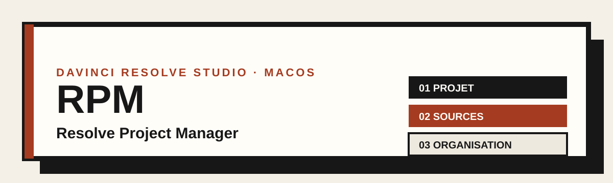

<p align="center">
  
</p>

<p align="center">
  <a href="https://github.com/plouis375/rpm-resolve-project-manager/releases/latest"></a>
  
  
</p>

Assistant macOS pour **DaVinci Resolve Studio** : il crée un projet, classe les médias dans le Media Pool et prépare la timeline de montage. Il s’ouvre depuis le menu de Resolve et se ferme quand le projet est prêt.

<p align="center">
  <a href="https://github.com/plouis375/rpm-resolve-project-manager/releases/latest"><strong>Télécharger la dernière version</strong></a> · <a href="CHANGELOG.md">Historique des versions</a>
</p>

## Ce qu’il fait

- Analyse des dossiers sources : médias reconnus, durée, taille, doublons probables.
- Classement automatique des rushs par marque de caméra, modèle et date de tournage.
- Création du projet, des chutiers et import des médias retenus, avec un rapport final.
- Timeline d’assemblage facultative, avec résolution et fréquence réglables.
- Color Space Transform automatique sur chaque plan selon la caméra (voir plus bas).
- Préparation des proxies avec Blackmagic Proxy Generator.

## Prérequis

- macOS et DaVinci Resolve Studio.
- Une bibliothèque de projets Resolve accessible.
- Les médias source accessibles depuis ce Mac (disque local ou volume monté).
- `ffprobe` est inclus dans l’archive, universel Intel et Apple Silicon. Si `ffprobe` ne peut pas tourner, le plugin tente une analyse partielle avec Spotlight.

Testé avec DaVinci Resolve Studio 21.1.1 sur macOS. Les autres versions de Resolve peuvent se comporter différemment.

## Installation

1. Télécharge le fichier `.pkg` depuis la [dernière version](https://github.com/plouis375/rpm-resolve-project-manager/releases/latest).
2. Ferme DaVinci Resolve, puis ouvre le `.pkg` par double-clic. L’installeur demande ton mot de passe administrateur pour copier le plugin dans le dossier partagé de Resolve.
3. Si macOS bloque le paquet (il n’est pas signé ni notarié, faute de compte développeur Apple), ouvre **Réglages Système → Confidentialité et sécurité** et choisis **Ouvrir quand même**.
4. Rouvre Resolve et choisis **Workspace → Workflow Integrations → RPM - Resolve Project Manager**.

Après une mise à jour, redémarre Resolve avant d’ouvrir le plugin. Une sauvegarde horodatée de la version précédente est conservée dans `.backups`, dans le dossier des intégrations Resolve.

**Désinstaller** : clique sur le bouton en bas de la première étape du plugin, puis redémarre Resolve. Les projets et les médias ne sont pas supprimés.

## Utilisation

1. **Projet** : saisis le nom du projet. Il est créé dans la bibliothèque et le dossier sélectionnés dans Resolve.
2. **Sources** : ajoute un ou plusieurs dossiers. L’analyse parcourt les sous-dossiers. Tu peux chercher un fichier, changer sa catégorie ou l’exclure. **Actualiser** relit les dossiers pour repérer les nouveaux médias et les fichiers retirés. Tes corrections manuelles sont conservées.
3. **Organisation** : renomme, ajoute ou retire les chutiers, choisis la timeline d’assemblage et ses réglages. Un aperçu montre l’arborescence qui sera créée. Tu peux enregistrer ta structure comme préférence pour les prochains projets.
4. **Création** : le plugin crée le projet, les chutiers et importe les médias retenus. Un rapport indique les imports réussis et ceux à vérifier.
5. **Montage** : le bouton final ouvre la page Edit et ferme l’assistant.

## Organisation créée dans Resolve

Modèle de base, dans le Media Pool :

```text
Nom du projet
├── Rushs
│   └── Marque de caméra
│       └── Modèle
│           └── Date de tournage
├── Assets
├── Éléments
├── Séquences
├── Musiques
└── Exports
```

Les autres types de médias sont rangés directement dans leur chutier. La structure peut être modifiée avant la création. **Enregistrer comme structure préférée** la garde sur ce Mac ; **Revenir au modèle de base** la supprime.

Le plugin travaille **dans Resolve uniquement** : il ne crée pas de dossiers Finder et ne déplace ni ne copie les sources.

## Formats reconnus

- **Rushs vidéo** : MOV, MP4, M4V, MXF, AVI, MPG/MPEG, MKV, MTS/M2TS, BRAW, R3D, ARI, CRM, 3GP, WEBM.
- **Audio** : WAV, AIF/AIFF, MP3, M4A, AAC, FLAC, OGG, OPUS, WMA.
- **Images** : PNG, JPG/JPEG, TIF/TIFF, BMP, WEBP, HEIC/HEIF, EXR, DPX, DNG, ARW, CR2/CR3, NEF, RAF.
- **Assets graphiques** : PSD, AI, EPS, SVG, PDF.
- **Séquences** : FCPXML, EDL, AAF, DRT, OTIO, XML autonomes.

Les fichiers cachés et les sous-dossiers `Proxy` sont ignorés. Un XML sidecar Canon (`CLIP.XML`) ou Sony (`C0001M01.XML`) associé à une vidéo sert de fiche de métadonnées : il n’apparaît pas comme séquence.

Pour la date de tournage, le plugin lit les métadonnées, puis utilise la date de création du fichier en repli (signalée dans l’analyse). Les caméras non reconnues restent modifiables avant la création.

## Doublons et alertes

- Les doublons probables sont repérés par **nom, taille et durée**. Les doublons ultérieurs sont exclus par défaut et peuvent être réinclus.
- **Comparer le contenu des doublons probables** calcule une empreinte SHA-256 sur les seuls groupes suspects, pour confirmer ou écarter les doublons. La lecture complète peut être longue sur de gros fichiers.
- L’écran Sources regroupe les alertes (fichiers vides, analyse indisponible, caméra à identifier, date de repli, doublons) et permet de filtrer.
- Les alertes n’empêchent pas la création. Les fichiers originaux ne sont ni modifiés ni supprimés.

## Harmonisation des noms de caméra

L’étape Organisation peut proposer de regrouper des marques ou modèles aux noms proches. Rien ne change tant que tu ne cliques pas sur **Regrouper**.

## Timeline d’assemblage (facultative)

Si l’option est cochée, Resolve crée `Nom du projet — Assemblage` dans le chutier Séquences, avec les rushs retenus bout à bout (à la racine si ce chutier a été retiré).

- **Résolution** : HD, Full HD, 2K/4K DCI, Ultra HD, vertical ou carré.
- **Fréquence** : de 23,976 à 60 i/s.
- **Automatique** : reprend le format majoritaire des rushs. Sans format dominant, repli sur 1920 × 1080 à 24 i/s.

Cette timeline est un point de départ : elle ne coupe pas les plans et ne choisit pas de prises.

### Color Space Transform

Avec l’option **Appliquer un Color Space Transform**, chaque plan reçoit un node CST selon sa caméra :

- Sony FX3, FX6, FX9, Burano (S-Gamut3.Cine / S-Log3)
- Canon C50, C70 (Cinema Gamut / Canon Log 2)
- Canon R5 (Cinema Gamut / Canon Log 3)

Sortie au choix : Rec.709-A (visionnage sur Mac) ou Rec.709 Gamma 2.4 (diffusion). Les plans d’autres caméras restent sans étalonnage et sont signalés dans le rapport. Le chutier Exports n’est pas modifié.

## Proxies avec Blackmagic Proxy Generator

Coche « Préparer la génération de proxies » à l’étape Organisation. Le guide de fin ajoute les dossiers sources à la liste surveillée de Blackmagic Proxy Generator, puis ouvre l’application. Ferme-la avant de cliquer si elle est déjà ouverte.

Les proxies sont écrits dans des sous-dossiers `proxy` à côté des médias, et Resolve les associe à leurs originaux. Le plugin modifie le fichier de préférences de Blackmagic Proxy Generator ; Blackmagic ne documente pas d’API pour cela, donc un changement de format pourrait demander une mise à jour du plugin.

## Hors périmètre

- Archivage de projet.
- Création de dossiers Finder ou sauvegarde des médias.
- Estimation de l’espace disque des proxies (voir Blackmagic Proxy Generator).
- Presets et réglages de rendu des exports.

## Dépannage

- **Le plugin n’apparaît pas dans Workspace** : vérifie l’installation, puis redémarre Resolve.
- **Resolve refuse la connexion** : ferme et rouvre Resolve. Si ça persiste, réinstalle la dernière version.
- **Caméra « À identifier »** : corrige la marque et le modèle dans la liste avant de créer le projet. Les XML Canon sont lus automatiquement.
- **Un fichier n’est pas importé** : consulte le rapport final, vérifie que son volume est monté et que le format est pris en charge par ta version de Resolve.

## Développement

- Code du plugin : [`plugin/`](plugin/). La logique de classement est dans [`plugin/lib/media.js`](plugin/lib/media.js).
- Tests : `npm test` (Node 20+, sans Resolve). Les rushs de `rush test/` restent locaux et ne sont pas versionnés.
- Le paquet est fabriqué par `package.command` (réservé au développeur) : il produit `dist/RPM-Resolve-Project-Manager-vX.Y.Z.pkg`.

### Publier une version

1. Mets à jour la version dans `plugin/package.json` et `plugin/manifest.xml`, puis ajoute une entrée dans `CHANGELOG.md`.
2. Committe les changements.
3. Lance `bash package.command` pour fabriquer le `.pkg`.
4. Crée le tag et la release GitHub avec le `.pkg` en pièce jointe.

## Licence

Tous droits réservés. Le code est visible publiquement, mais sa réutilisation, sa copie et sa redistribution ne sont pas autorisées sans accord écrit de l’auteur.
